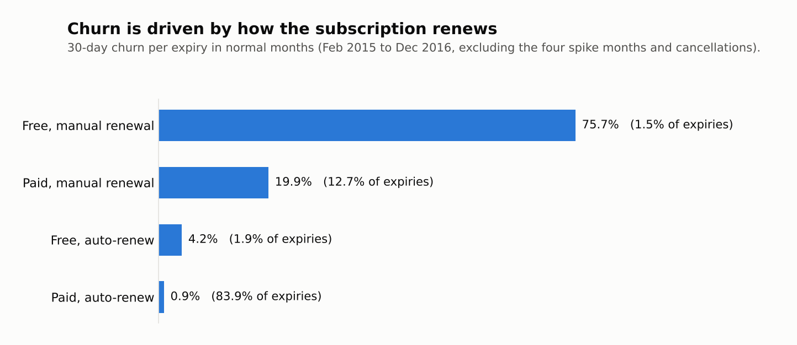

# Subscription analytics for a music streaming service (KKBox)

A product and retention analysis of a subscription business, done almost entirely in SQL (PostgreSQL) on about 23 million transactions and 18 million daily usage records.

The questions are the ones a growth team asks: where does the funnel leak, what actually drives churn, do promotions pay off, and which lost subscribers are worth chasing. The work is written as an analyst answering a stakeholder, the Head of Growth, and the answers are in [REPORT.md](REPORT.md).

## Key findings

1. **Churn is driven by how a subscription renews, not by how much the product is used.** In normal months, manual-renewal transactions are 14% of expiries and 81% of churn. Paid auto-renew expiries churn at 0.9%; paid manual ones at 19.9%.
2. **The loss happens in the first month.** A typical cohort keeps 94% to 99% of its users to the end of the entry month and roughly 70% to 85% a month later. After that the curve flattens.
3. **Free promotions bring volume that does not turn into subscribers.** The November 2016 promotion cohort was 3.6 times the size of December's and left about the same number of subscribers three months later. Users who started free are 25% of new users and about 5% of first-180-day revenue.
4. **Low usage does signal churn, but weakly next to renewal type.** The most engaged manual-renewal users churn at 32%; auto-renew users who did not open the app all week churn at 4%.
5. **Almost everyone tries the app; few make it a habit in the first week.** 91% of new registrants are active at least once in their first seven days, 40% on three or more days, 14% on five or more.
6. **Conversion happens in the first month or not at all.** One channel holds 8% of registrations and about 55% of 30-day conversions.
7. **How a subscription ends predicts whether the user returns.** Within a year, 11% of users who cancelled come back, 34% of manual-renewal users who let it lapse, and 86% of auto-renew users who lapsed without cancelling.

The funnel end to end (each step is measured on the population and period where it is observable, so the steps are not one cohort followed through):

| Step | Result | Source |
|---|---|---|
| Registration to first-week activation (3+ active days) | 40% | q08 |
| Registration to first payment within 30 days | 12.8% | q06 |
| First payment to still subscribed one month later | roughly 70% to 85% | q02 |
| Monthly churn of the subscriber base | 4% to 10% | q01 |
| Lost subscribers back within a year | 39% | q07 |




More charts are in [charts/](charts/), and every number above is traceable to a file in [results/](results/).

## What this project demonstrates

- **Metric definition before analysis.** The definitions in [METRICS.md](METRICS.md) were fixed after the data quality audit and before any business question was run: each metric has an exact definition, the alternative that was rejected and why. Validation checks found later were added to it, marked as such. Churn is reported under 15-, 30- and 60-day windows to show how much the number depends on the definition.
- **Data quality as a first-class step.** [sql/01_data_quality.sql](sql/01_data_quality.sql) audits every table and each finding becomes a documented decision (see below).
- **Turning an event log into state.** Transactions are events; "was this user a subscriber on day X" is state. [sql/03_subscription_periods.sql](sql/03_subscription_periods.sql) builds subscription periods with a gaps-and-islands approach.
- **Care with time and causality.** Right-censoring is handled explicitly in every question. The engagement analysis only uses usage that precedes expiry, to avoid measuring the consequence of churn as its cause. Correlations are reported as correlations, with the experiment that would test them.
- **SQL techniques:** window functions (`LEAD`, `LAG`, running sums), gaps-and-islands, `DISTINCT ON`, range joins against generated month ends, conditional aggregation with `FILTER`, ordered-set aggregates (`PERCENTILE_CONT`), set operations for de-duplication.

## Data

[WSDM - KKBox's Churn Prediction Challenge](https://www.kaggle.com/c/kkbox-churn-prediction-challenge) (Kaggle). KKBox is a music streaming service. The data is not included in this repository; see [data/README.md](data/README.md) for the files and how to load them.

| Table | Rows | Content | Period |
|---|---|---|---|
| `members` | 6,769,473 | Registration date and channel | 2004 to Apr 2017 |
| `transactions_v1` + `transactions_v2` | 22,978,755 | Payments, renewals, cancellations | Jan 2015 to Mar 2017 |
| `user_logs` | 18,396,362 | Daily listening activity per user | Mar 2017 |
| `train` | 970,960 | Official churn label for users expiring in Mar 2017 | Mar 2017 |

## Data quality notes

| Finding | Impact | Decision |
|---|---|---|
| Age is invalid for 67.2% of members and gender is null for 65.4%; `city = 1` holds 71.0% | Unusable as segments | Not used |
| 18.0% of paying users (437,810) have no `members` record, and their churn is lower (5.35% vs 9.46%) | Anything by channel or registration date covers 82% of payers and overstates churn | Documented as a bias |
| The two transaction files share no identical row, and only 2.8% of the older rows in v2 match a v1 user and date | They are complementary | Stacked |
| 3,339 exact duplicate rows in v1 | Double-counts revenue | Removed |
| Plan length is 0 days in 870,124 rows and list price is 0 in 1.5 million, concentrated in Mar to Oct 2015 | A logging failure of that period, not real plans | Duration always from the expiry date; revenue from the amount paid; discount only where a list price exists |
| 153,660 rows expire before their transaction date; 95.8% of them are cancellations | A cancellation shortens the expiry, which is legitimate | Kept when it is a cancellation, removed otherwise |
| 1.28% of user-days hold more than one transaction (up to 156) | Ambiguous state for that day | Latest expiry wins; amounts summed |
| 4,200 log rows show more than 24 hours of listening in a day | Impossible; distorts averages | Removed |
| Usage logs hold exactly one row per user per day, with no gaps in the month | `COUNT(*)` per day is DAU | No treatment needed |

After cleaning: 22,968,708 transactions, 2,425,951 paying users.

## Repository structure

```
├── README.md
├── REPORT.md                  findings and recommendations for the Head of Growth
├── METRICS.md                 metric dictionary, definitions fixed before the analysis
├── data/README.md             where to get the data and how to load it
├── sql/
│   ├── 00_schema.sql              raw tables, import notes, indexes
│   ├── 01_data_quality.sql        audit of every table
│   ├── 02_base_tables.sql         clean transaction table and views
│   ├── 03_subscription_periods.sql  event log -> subscription periods
│   ├── q01_churn_trend.sql        churn over time, what explains the spikes, window sensitivity
│   ├── q02_cohort_retention.sql   cohort retention matrix
│   ├── q03_free_vs_paid_start.sql do free promotions turn into revenue?
│   ├── q04_engagement.sql         DAU/MAU and the distribution of usage
│   ├── q05_engagement_vs_churn.sql does low usage predict churn?
│   ├── q06_conversion_by_channel.sql registration to first payment, by channel
│   ├── q07_winback.sql            who comes back after leaving, and when
│   └── q08_activation.sql         first-week activation of new registrants
├── results/                   query outputs as CSV
├── charts/                    charts built from results/
└── scripts/make_charts.py     rebuilds the charts
```

## How to reproduce

1. Download the data and create the tables: [data/README.md](data/README.md) and `sql/00_schema.sql`.
2. Run `01_data_quality.sql` (read-only), then `02_base_tables.sql` and `03_subscription_periods.sql`, which build the tables every question reads from.
3. Run the `q0x` files in order. `q02` creates a table that `q04` uses.
4. Rebuild the charts from the saved outputs:

```
pip install -r requirements.txt
python scripts/make_charts.py
```

Tested on PostgreSQL 16; nothing in the SQL is specific to that version. Building the base tables takes a few minutes on a laptop; each question then runs in seconds to a couple of minutes.

## Limitations

- **Usage logs cover one month.** Engagement is a snapshot of March 2017; there is no DAU/MAU trend and no usage-based retention matrix. The cohort matrix is subscription retention.
- **Transactions start in January 2015.** Cohorts only include users registered from that date, so they describe newer subscribers, not the base that already existed.
- **Possible selection effect at the end of the data.** Churn in January and February 2017 and the retention of the last two cohorts look better than any earlier period. The dataset was assembled around users with subscriptions expiring in February and March 2017, which may favour users who had just renewed. This could not be tested, so those months are reported but not used to claim an improvement.
- **Part of the measured churn is probably involuntary or an artifact.** 86% of auto-renew users who lapse without cancelling are back within 180 days. That points to failed payments or to transactions missing from the 2015 data rather than to a decision to leave, and the 30-day window counts them as churned.
- **Registration channels are anonymised codes.** One of them converts at 86% on the day of registration, which looks like sign-up at the point of purchase rather than an acquisition channel. Channels are compared, not interpreted.
- **Everything here is observational.** Differences between auto-renew and manual users reflect who chooses each option as much as the option itself.

## Next steps

- Link activation to conversion at user level: do registrants who reach three active days in the first week pay more often? q08 only shows that the two move together across channels.
- Split the auto-renew lapses by payment method to separate failed payments from missing data.
- Replace the fixed 30-day churn window with a survival analysis that handles censoring directly.
