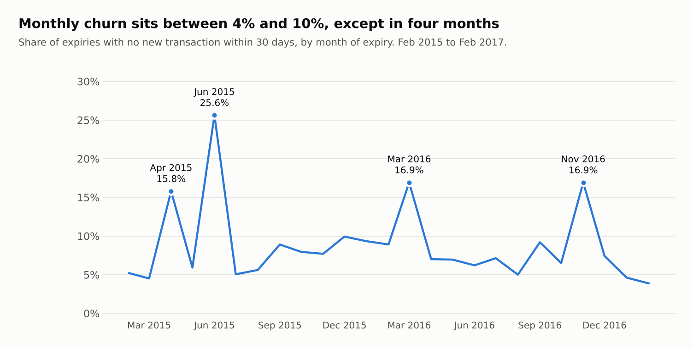
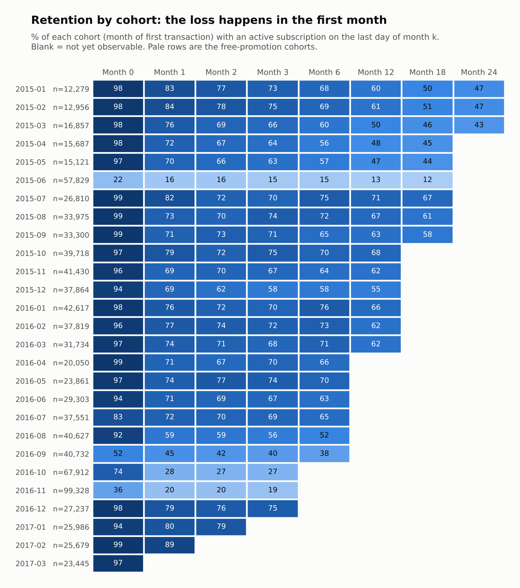
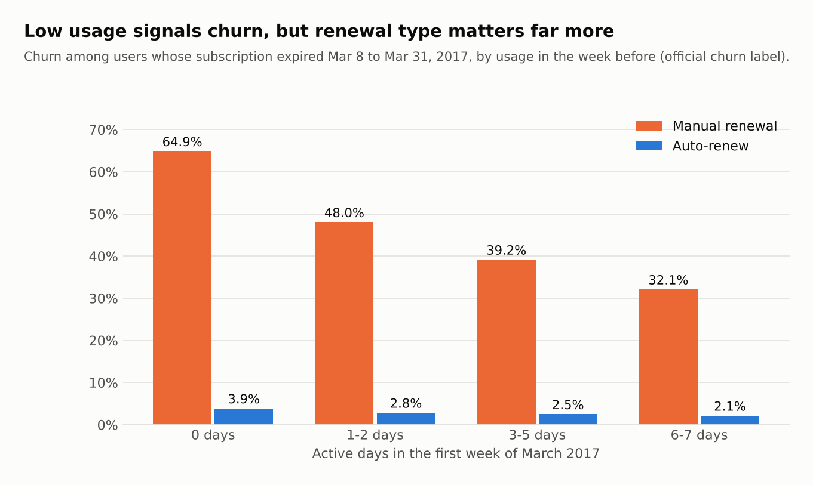
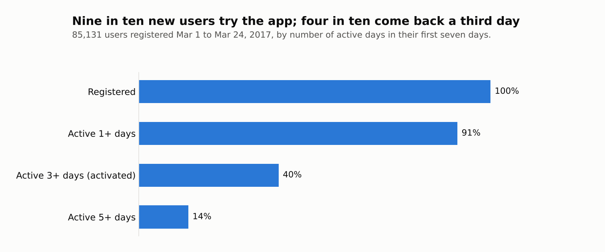
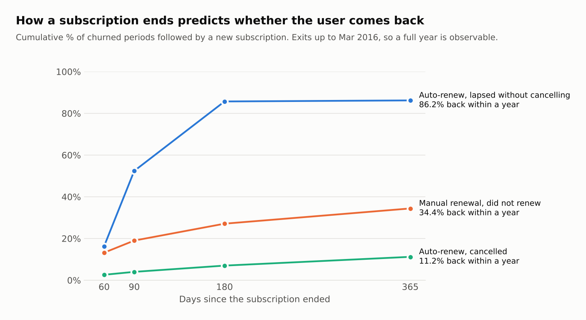

# Where the subscription funnel leaks, and what to do about it

**To:** Head of Growth
**Scope:** 2.4 million paying users, January 2015 to March 2017; usage data for March 2017
**Definitions:** [METRICS.md](METRICS.md) · **Queries:** [sql/](sql/) · **Outputs:** [results/](results/)

## Summary

Churn in this business is mostly a renewal problem, not an engagement problem. Subscribers on auto-renew almost never leave; subscribers who renew by hand leave about twenty times more often, even though they are the heaviest users of the app. Free promotions add a second, self-inflicted source of churn: they bring very large cohorts that disappear within a month and contribute about 5% of new users' revenue.

The funnel in one view (each step is measured where it is observable, so these are not one cohort followed through):

| Step | Result |
|---|---|
| New registrants active 3+ days in their first week | 40% |
| Registrants who pay within 30 days | 12.8% |
| New subscribers still subscribed one month later | roughly 70% to 85% |
| Monthly churn of the subscriber base | 4% to 10% |
| Lost subscribers back within a year | 39% |

The three main recommendations, in order of expected impact (all six are at the end):

1. Test making auto-renew the default for new subscribers, with a control group.
2. Test the free-promotion format before running another one with manual renewal: auto-renew enabled, against a holdout group.
3. Test renewal reminders and one-step renewal for engaged manual-renewal users, the largest single source of churn.

## 1. Churn is driven by how the subscription renews

Monthly churn (no new transaction within 30 days of expiry) stays between 4% and 10%, apart from four months that reach 16% to 26%.

In normal months the split by transaction type is stark:

| Transaction | Share of expiries | 30-day churn |
|---|---|---|
| Paid, auto-renew | 83.9% | 0.93% |
| Paid, manual renewal | 12.7% | 19.92% |
| Free, auto-renew | 1.9% | 4.17% |
| Free, manual renewal | 1.5% | 75.70% |

Manual renewal accounts for 14% of expiries and 81% of churn.

The four spike months have two causes. Free manual-renewal transactions jump from 1.5% to 10.2% of expiries and churn at 94%; they explain about 57% of churn in those months. The other 30% comes from paid auto-renew, whose churn rises from 0.93% to 6.64% in the same months. Promotions do not explain that second part. A failed billing run or a price or payment change would; the data cannot tell which.

Cancellation and churn move separately. The cancellation rate falls from 6.9% in December 2015 to about 2% by the second half of 2016, while churn keeps oscillating, and the spike months have some of the lowest cancellation rates in the series. Users who leave mostly just do not renew.

**How fragile is the number?** Moving the window from 15 to 30 to 60 days changes 2016 churn from 10.3% to 9.2% to 8.2%. About a fifth of the users who look lost at 15 days are back by 60.

*Source: q01.*

## 2. The loss happens in the first month

A typical cohort keeps 94% to 99% of its users to the end of the month they first pay, and roughly 70% to 85% one month later. After that the curve flattens: from month 1 to month 12 it loses another 5 to 25 points, against 10 to 28 in the first month alone. Half of all subscription periods that end in churn last 30 days or less.

Retention sometimes rises from one month to a later one (for example the July 2015 cohort, 70% at month 3 and 75% at month 6). The metric counts whoever is active at month end, so users who left and came back are counted again. Those rises line up with November 2015 and July 2016, when the total subscriber base also jumps, which suggests reactivation campaigns.

The subscriber base itself more than doubled, from 528,000 at the end of January 2015 to 1.17 million at the end of March 2017, while the auto-renew share fell from 87% at the start of 2015 to about 76% by mid-2015 and then stayed between 71% and 77%.

*Source: q02, 03.*

## 3. Free promotions bring volume that does not turn into subscribers

Four cohorts stand apart in the matrix, and they are the months with free transactions:

| Cohort | Size | Active at end of entry month | Active at month 3 |
|---|---|---|---|
| Jun 2015 | 57,829 | 21.6% | 15.2% |
| Sep 2016 | 40,732 | 51.5% | 40.0% |
| Oct 2016 | 67,912 | 74.1% | 26.9% |
| Nov 2016 | 99,328 | 36.2% | 19.1% |

November 2016 brought 99,328 new users and kept 19.1% at month 3, about 19,000 people. December 2016, with no promotion, brought 27,237 and kept 74.6%, about 20,000. 3.6 times the volume for the same outcome.

Following each user for 180 days after their first transaction:

| How they started | Users | Paid at least once | Avg revenue per user |
|---|---|---|---|
| Paid, auto-renew | 286,705 | 100% | 663 |
| Paid, manual renewal | 195,948 | 100% | 784 |
| Free, auto-renew | 60,419 | 36.5% | 202 |
| Free, manual renewal | 105,048 | 7.6% | 53 |

Users who started free are 25.5% of new users and about 5% of revenue in the window. The problem is conversion, not value: the free starters who do pay spend about as much as everyone else (699 and 554 per paying user). Free trials with auto-renew convert almost five times better than free trials without it.

Two cautions. Manual payers show higher revenue than auto-renew payers (784 vs 663) most likely because they buy long plans up front, which pulls revenue into the 180-day window; over a longer horizon the order may reverse. And the auto-renew advantage is partly self-selection: users who accept automatic billing were more likely to stay anyway.

*Source: q02, q03.*

## 4. Usage is concentrated, and it predicts churn only weakly

In March 2017 the app had 1.10 million monthly active users and an average of 593,000 daily, a DAU/MAU ratio of 53.7%. Requiring at least one fully played song changes that to 53.9%, so the result does not depend on the definition of "active".

The average hides the distribution: 43% of users were active on 21 days or more and produced 69% of all usage days; 22% were active on 5 days or fewer and produced 3%. Intensity follows frequency, from a median of 10 minutes per active day for one-day users to 134 minutes for near-daily users.

Does low usage warn of churn? For users whose subscription expired between March 8 and March 31, comparing usage in the week of March 1 to 7 with the official churn label:

The signal exists in both groups: users with no activity churn about twice as often as near-daily users. But renewal type dominates. The most engaged manual-renewal users (32.1%) churn eight times more than auto-renew users who did not open the app (3.9%).

Two details matter for what to do about it. Manual-renewal users are the more engaged group: half of them were active 6 or 7 days that week, against 30% of auto-renew users. And the largest block of churn in absolute terms is exactly those engaged manual users (13,536 churners), not the inactive ones. An alert on low usage would catch the 0-to-2-day band, which churns at 53% but holds only 26% of manual-renewal churn. Making renewal easier for people who already use the product reaches more of it.

A quarter of auto-renew users (127,000) did not open the app that week and nearly all kept paying. That is one week of data, but it is a group worth watching.

*Source: q04, q05.*

## 5. Almost everyone tries the app; few make it a habit in the first week

Of the 85,131 users who registered between March 1 and March 24, 2017:

Nine in ten open the app in their first week, so the product does get its chance. The drop comes right after: only four in ten are active on three or more days, the threshold used here for activation.

| Channel | Share of registrations | Active 1+ days | Activated (3+ days) | Active 5+ days |
|---|---|---|---|---|
| 4 | 76.4% | 90.8% | 34.4% | 9.1% |
| 7 | 9.1% | 82.5% | 59.1% | 37.1% |
| 3 | 7.5% | 94.6% | 49.2% | 17.3% |
| 9 | 6.4% | 95.0% | 61.6% | 32.8% |
| other | 0.7% | 88.9% | 72.4% | 53.0% |

Channel 4 brings three quarters of new registrants and activates the fewest of them (34%). It is also the channel that converts worst (section 6). Among the three comparable channels, activation and conversion rank in the same order: 4, then 3, then 9. That is a pattern across channels, not proof that activation causes payment; the user-level link was not measured.

The measurement holds up: about 90% of registrants who had not paid still appear in the usage logs in their first week, so activation here is not just a mirror of who paid.

*Source: q08.*

## 6. Conversion happens in the first month or not at all

| Channel | Share of registrations | Paid within 30 days | Ever paid | Median days to first payment |
|---|---|---|---|---|
| 4 | 65.0% | 3.34% | 4.62% | 7 |
| 3 | 14.1% | 7.94% | 13.69% | 16 |
| 9 | 12.3% | 19.31% | 24.45% | 3 |
| 7 | 8.2% | 86.39% | 89.97% | 0 |
| other | 0.4% | 20.85% | 23.54% | 0 |

Overall, 12.8% of registrants pay within 30 days. In every channel the gap between "within 30 days" and "ever" is small: a user who has not paid in the first month rarely does.

Channel 7 holds 8% of registrations and about 55% of conversions, while channel 4 holds 65% of registrations and about 17%. Channel codes are anonymised, and an 86% conversion on the day of registration looks like sign-up at the point of purchase rather than a marketing channel. It should not be read as "invest in channel 7". The useful comparison is among channels 3, 4 and 9, where conversion ranges from 3% to 19%.

*Source: q06.*

## 7. How a subscription ends predicts whether the user comes back

One in five users has had more than one subscription period. Among subscriptions that ended by March 2016:

- **Cancelled (auto-renew):** 11% return within a year. An explicit cancellation is close to final.
- **Manual renewal, not renewed:** 34% return within a year, spread across the year. This is the natural audience for a win-back campaign.
- **Auto-renew, lapsed without cancelling:** 86% return within 180 days. This does not look like a decision by the user. The likely explanations are failed payments (involuntary churn) or transactions missing from the 2015 data.

*Source: q07.*

## Recommendations

1. **Test auto-renew as the default for new subscribers.** The difference between renewal types is the largest effect in the data, but it is observational. An experiment that assigns the default at random for a share of new subscribers would measure how much of the gap is the feature and how much is the kind of user who chooses it.
2. **Test the free-promotion format before running another manual-renewal promotion.** In the data, those promotions inflate churn in the following months, convert at 7.6%, and the one month compared (November against December 2016) produced no more retained subscribers than an ordinary month. That is one observational comparison, not proof. Running the next promotion with auto-renew enabled, against a holdout group that gets no promotion, would show whether promotions add subscribers at all and which format works.
3. **Make renewal easier for engaged manual users.** They are the largest source of churn and they already use the product. Renewal reminders before expiry and a one-step renewal are the obvious candidates, again measured against a control.
4. **Test win-back on lapsed manual users first.** A third of them return within a year on their own, against 11% of users who cancelled. A campaign measured against a control group would show how much it adds on top of those natural returns.
5. **Test onboarding changes in the first week of channel 4.** It supplies most new registrants, and two thirds of them do not come back for a third day. Since users who have not paid in the first month rarely pay later, onboarding in that week is where that channel's conversion is likely decided. Any change there should be measured against a control, since the link between activation and payment was only seen across channels.
6. **Check the auto-renew lapses against billing data** before treating them as churn. If they are failed payments, payment retries are cheaper than any campaign, and reported churn is overstated.

## Limitations

- Everything here is observational. No finding establishes cause.
- Usage data covers one month, so engagement is a snapshot and the cohort matrix measures subscription retention, not usage retention.
- Cohorts and channel results cover users registered from January 2015 with a registration record. The 18% of payers without one churn less, so churn by channel is overstated.
- Churn in January and February 2017 and the last two cohorts look better than any earlier period. The dataset was built around users expiring in February and March 2017, which may favour recent renewers. Those figures are reported but not used to claim improvement.
- The 30-day churn window counts auto-renew lapses that return within months. Churn figures for that group are an upper bound.
- Activation is measured on one month of registrations (March 2017) and its link to payment is shown only across channels.
- Amounts are in New Taiwan dollars.
